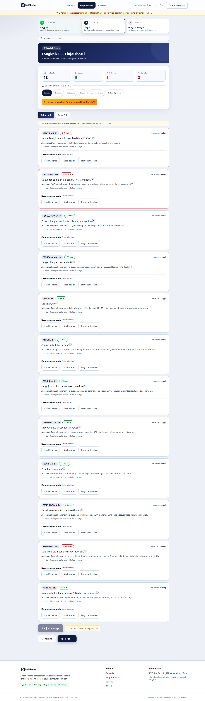
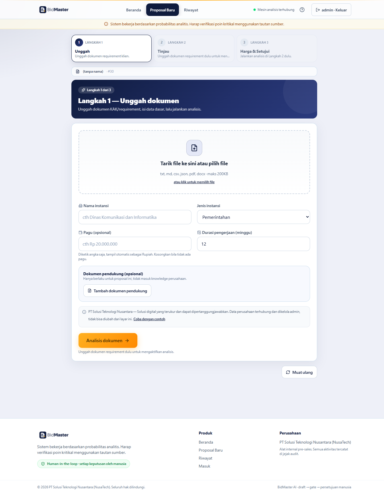
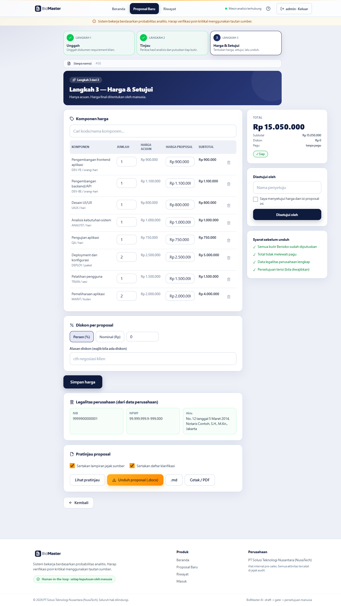
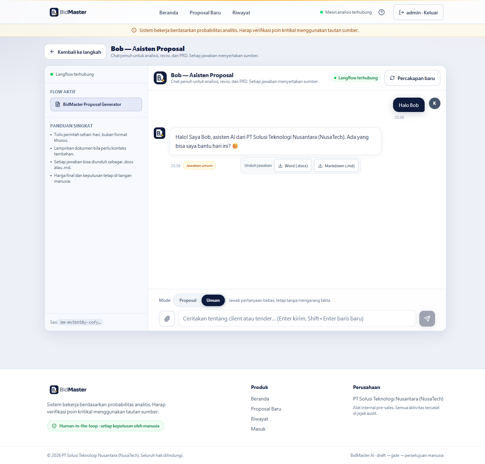

<div align="center">

# BidMaster AI

**Asisten pre-sales yang memeriksa dokumen tender baris per baris — dengan sitasi, gate, dan keputusan manusia.**

Dikembangkan oleh **PT Solusi Teknologi Nusantara (NusaTech)** untuk IBM National Hackathon 2026.

[](https://laravel.com)
[](https://react.dev)
[](https://www.php.net)
[](https://www.typescriptlang.org)
[](https://docs.docker.com/compose)
[](https://www.langflow.org)
[](#pengujian)

</div>

---

## Daftar Isi

1. [Pengenalan Proyek](#1-pengenalan-proyek)
2. [Ikhtisar dan Fitur Proyek](#2-ikhtisar-dan-fitur-proyek)
3. [Tech Stack, API, dan Sumber Daya Lainnya](#3-tech-stack-api-dan-sumber-daya-lainnya)
4. [Memulai: Petunjuk Pengaturan dan Menjalankan](#4-memulai-petunjuk-pengaturan-dan-menjalankan)
5. [Cara Berkontribusi dan Melaporkan Masalah](#5-cara-berkontribusi-dan-melaporkan-masalah)
6. [Kesimpulan dan Lisensi](#6-kesimpulan-dan-lisensi)

---

## 1. Pengenalan Proyek

### Latar belakang

Tim pre-sales menerima dokumen tender (KAK/requirement) yang tebal — campuran kebutuhan teknis, legal, dan komersial. Mereka harus menjawab manual: kebutuhan mana yang terpenuhi, bukti apa untuk tiap klaim, dan berapa RAB yang tidak melewati pagu. Cara lama (template Word manual atau chat AI generik) lambat, tidak konsisten antar anggota, dan rawan salah hitung — satu angka salah bisa menggugurkan penawaran.

### Masalah yang diselesaikan

- **Klaim tanpa sumber.** Chat AI generik mengarang harga, pengalaman, dan sertifikasi tanpa bukti yang bisa diverifikasi panitia.
- **Tidak konsisten.** Tiap anggota tim memakai template dan asumsi berbeda.
- **Rawan salah hitung.** RAB manual mudah keliru dan melewati pagu.
- **Tanpa jejak.** Sulit melacak siapa memutuskan apa dan kapan.

### Solusi

**BidMaster AI** mengubah alur itu menjadi tiga langkah terarah: unggah dokumen → AI menganalisis **tiap butir** dengan **sitasi ke teks asli** → manusia memutuskan tiap butir → harga ditentukan manusia per baris → **gate** memblokir unduhan sampai syarat terpenuhi → ekspor DOCX ber-cover logo.

> **Prinsip inti:** ini bukan chatbot bebas. Harga hanya diambil dari katalog sebagai **acuan**. Fakta tak pasti ditandai `[perlu konfirmasi]`. Status keluaran selalu *draft* sampai manusia menyetujui.

### Alur arsitektur singkat

```
Tim → React 19 (wizard 3 langkah) → Laravel 13 API → Langflow (RAG K01–K18) → item + sitasi
                                   ↘ gate (KAK/pagu/legalitas) → harga manusia → approve → DOCX
                                   ↘ /api/agent → Bob (flow Langflow yang sama, mode Proposal/Umum)
```

### Tangkapan layar

> **Catatan:** gambar di bawah akan tampil setelah Anda mengunggahnya. Lihat [bagian gambar](#cara-mengunggah-gambar-readme) di bawah.


*Halaman landing publik — mobile-first, menyatakan kepemilikan NusaTech.*


*Langkah 2: tiap klaim punya angka sitasi yang membuka popover sumber.*

---

## 2. Ikhtisar dan Fitur Proyek

### Alur 3 langkah

| Langkah | Nama | Yang terjadi |
|---|---|---|
| **1** | **Unggah** | Unggah requirement (txt/md/csv/json/pdf/docx ≤200KB) + dokumen pendukung opsional; isi instansi/pagu/jenis/durasi; tekan **Analisis dokumen**. |
| **2** | **Tinjau** | Tiap butir punya status + alasan + keyakinan + sitasi. Putuskan **Benar / Ubah / Tanyakan ke klien**. Butir **Berisiko wajib diputuskan**. |
| **3** | **Harga & Setujui** | Harga acuan read-only + harga proposal editable (alasan wajib bila beda), diskon + alasan; gate lolos → **Unduh DOCX**. |

### Fitur utama

- **Unggah dengan penanda stabil** — lokasi sumber memakai nomor **baris** (teks) atau **halaman + paragraf** (PDF/DOCX), sehingga sitasi tetap akurat. Dokumen bisa diganti/dihapus (dengan animasi).
- **Analisis per butir** — keluaran `{kategori, requirement, kutipan, sumber_klien, sumber_knowledge[K..], status, alasan, keyakinan, komponen_usulan}`. Sumber klien **divalidasi backend** terhadap dokumen; tak cocok → ditandai `perlu dikonfirmasi`.
- **Sitasi angka → popover (gaya NotebookLM)** — angka kecil inline di teks butir; diklik membuka popover mengambang berisi cuplikan sumber, dengan tautan **"Lihat sumber lengkap"** ke panel samping (teks asli ter-*highlight* + konteks).
- **Human-in-the-loop tercatat** — Benar / Ubah (alasan wajib) / Tanyakan ke klien + catatan internal; approve massal untuk Sesuai-Tinggi; audit awal→akhir.
- **Harga ditentukan manusia** — acuan read-only, harga proposal editable, lencana selisih, alasan wajib; deviasi >15% atau diskon >10% → **Perlu persetujuan admin** + memblokir unduh; snapshot acuan disimpan.
- **Gate pemblokir** — 3 pemeriksaan: **KAK coverage**, **pagu**, **legalitas**. Belum lolos = belum bisa unduh.
- **Ekspor ber-cover** — DOCX dengan cover logo, header/footer, dan nomor halaman; tersedia juga `.md` dan Cetak/PDF; versi tersimpan dan bisa diunduh ulang.
- **Agen Bob** — tab **Tanya Bob** (Langkah 2) + halaman penuh **`/bob`**; **mode Proposal** (grounded ke knowledge) atau **mode Umum** (pertanyaan bebas); lampiran dokumen; unduh jawaban sebagai **.docx ber-cover** atau **.md**.
- **Ketahanan galat mesin AI** — galat Langflow (kuota 429, model tak dikenal, 5xx, tak terjangkau) diterjemahkan ke pesan Indonesia yang ramah + retry otomatis; opsi **analisis darurat tanpa AI** yang menandai semua butir Berisiko.
- **Keamanan & audit** — login peran, token sha256, throttle, CSP tanpa inline, unggahan di memori, audit penuh.

### Ketahanan galat mesin AI

Galat Langflow diklasifikasi menjadi pesan Indonesia yang ramah (bukan JSON mentah) + retry otomatis sekali:

| Kondisi | Kode | Tindakan |
|---|---|---|
| Kuota model habis (HTTP 429 / `RESOURCE_EXHAUSTED`) | `LF_QUOTA` | Pesan "kuota habis, tunggu/ganti model" + retry |
| Model tak dikenal (`No model class defined`) | `LF_MODEL` | Saran perbarui Langflow / ganti model |
| Langflow 5xx | `LF_SERVER` | Retry otomatis |
| Langflow tak terjangkau | `LF_UNREACHABLE` | Pesan "pastikan Langflow berjalan" |
| Keluaran tak terstruktur | `LF_FORMAT` | Minta ulang |

Detail teknis hanya masuk **log server**. Bila tetap gagal, pengguna diberi opsi **Lanjut tanpa AI (analisis darurat)**: setiap baris requirement jadi butir **Berisiko/keyakinan rendah** yang **wajib ditinjau manusia** — tidak ada yang lolos tanpa tinjauan.

### Tangkapan layar


*Langkah 1: unggah dokumen, isi data dasar, jalankan analisis.*


*Langkah 3: harga per baris, diskon, dan syarat sebelum unduh.*


*Halaman Bob: chat dengan mode Proposal/Umum dan unduh jawaban.*

---

## 3. Tech Stack, API, dan Sumber Daya Lainnya

### Tech stack

| Lapisan | Teknologi |
|---|---|
| **Frontend** | React 19, TypeScript 6, Vite 8, Tailwind CSS 4, React Router 7, lucide-react (ikon), shadcn-style components |
| **Backend** | Laravel 13 (PHP 8.4), PhpWord (DOCX), smalot/pdfparser (PDF), Symfony YAML |
| **Database** | SQLite (WAL mode, bind-mount file `data/bidmaster.sqlite`) |
| **AI/RAG** | IBM Langflow — flow `BidMaster Proposal Generator` (File → Split → Chroma + Embedding → Prompt → LLM) |
| **Agen** | IBM Bob via **MCP** (`skills/registry.yaml`) |
| **Infrastruktur** | Docker Compose — nginx (frontend + proxy) + PHP CLI server multi-worker |
| **Pengujian** | PHPUnit 12 (82 test), `tsc -b` + `vite build` |

### Prasyarat

- **Docker** (disarankan) — Docker Desktop / Engine + Compose v2.
- **Atau, jalur lokal:** PHP ≥ 8.3 (disarankan 8.4) dengan ekstensi `pdo_sqlite`, `zip`, `pcntl`; Composer 2; Node.js ≥ 20.
- **Opsional:** instance **IBM Langflow** yang berjalan (untuk analisis AI). Tanpa ini, aplikasi tetap jalan dan tombol analisis dinonaktifkan beralasan.

### Rute halaman (frontend)

| Rute | Halaman |
|---|---|
| `/` | Landing publik |
| `/login` | Masuk |
| `/app`, `/app/:id` | Wizard proposal (3 langkah) |
| `/bob` | Halaman penuh agen Bob |
| `/riwayat` | Riwayat proposal |

### Ringkasan API

Base URL: `http://localhost:8080/api`. Semua endpoint butuh header `Authorization: Bearer <token>` kecuali yang publik.

**Publik / tanpa token**

| Metode | Endpoint | Keterangan |
|---|---|---|
| `GET` | `/health` | Cek kesehatan → `{"ok":true}` |
| `GET` | `/catalog` | Katalog komponen + paket + aturan diskon |
| `GET` | `/company` | Identitas perusahaan (publik, untuk landing) |
| `GET` | `/agent/status` | Status integrasi Langflow |
| `POST` | `/login` | Masuk → token (throttle 10/menit) |
| `POST` | `/logout` | Keluar |

**Butuh token** (`throttle:120,1`)

| Metode | Endpoint | Keterangan |
|---|---|---|
| `GET` | `/me` | Profil pengguna aktif |
| `GET` | `/audit` | Riwayat audit |
| `GET` | `/proposals` | Daftar proposal |
| `GET` | `/proposals/{id}` | Detail proposal |
| `GET` | `/proposals/{id}/source` | Konteks teks asli untuk sitasi |
| `GET` | `/knowledge/quotes` | Kutipan knowledge (read-only, kode K) |

**Butuh peran** `admin` / `bd` / `reviewer`

| Metode | Endpoint | Keterangan |
|---|---|---|
| `POST` | `/draft` | Susun draf website/tender (throttle 30/menit) |
| `POST` | `/export` | Ekspor Markdown → DOCX (throttle 30/menit) |
| `POST` | `/agent` | Kirim pesan ke Bob (mode Proposal/Umum) |
| `POST` | `/agent/file` | Ubah jawaban Bob → file `.docx`/`.md` |
| `POST` | `/proposals` | Buat proposal |
| `PATCH` | `/proposals/{id}` | Autosave field |
| `DELETE` | `/proposals/{id}` | Hapus proposal |
| `POST` | `/proposals/{id}/upload` | Unggah requirement/pendukung |
| `DELETE` | `/proposals/{id}/file` | Hapus dokumen |
| `POST` | `/proposals/{id}/analyze` | Analisis AI (throttle 10/menit, dukung `fallback`) |
| `PATCH` | `/proposals/{id}/items/{item}/decision` | Putusan manusia per butir |
| `POST` | `/proposals/{id}/approve-sesuai` | Setujui massal Sesuai-Tinggi |
| `GET`/`PATCH` | `/proposals/{id}/prices` | Baca/simpan harga |
| `POST` | `/proposals/{id}/approve` | Persetujuan admin |
| `GET` | `/proposals/{id}/download-check` | Status gate unduhan |
| `POST` | `/proposals/{id}/preview` | Pratinjau dokumen |
| `POST` | `/proposals/{id}/export` | Ekspor proposal → DOCX |
| `GET` | `/proposals/{id}/versions` | Daftar versi |
| `GET` | `/proposals/{id}/versions/{versi}/file` | Unduh versi |

### Sumber daya lain

| Sumber daya | Lokasi |
|---|---|
| Template knowledge (sanitasi) | `knowledge/*.example` |
| Knowledge perusahaan (K01–K18) | `knowledge/perusahaan.example`, `knowledge_perusahaan.example` |
| Flow Langflow kanonis | `langflow/flows/bidmaster_proposal_generator_rag.json` |
| Panduan impor flow | `langflow/IMPORT_GUIDE.md` |
| Kontrak MCP tool | `skills/registry.yaml` |
| Konfigurasi Docker | `docker/` + `compose.yaml` |
| Konfigurasi contoh | `.env.example` |
| Basis data runtime | `data/bidmaster.sqlite` (gitignored) |

### Adaptasi untuk perusahaan Anda

```sh
cp knowledge/<nama>.example knowledge/<nama>.md    # atau .yaml, lalu edit
```

Token `{...}` di template **wajib dipertahankan**. Header `# CONTOH SANITASI` di-strip otomatis oleh loader. Identitas perusahaan diatur lewat `knowledge/perusahaan.example` + `knowledge_perusahaan.example`.

### Integrasi IBM Langflow & Bob

- **Langflow** mengeksekusi analisis RAG (project `Bidmaster_Proposal`, flow `BidMaster Proposal Generator`: File → Split → Chroma + Embedding → Prompt → Language Model). Knowledge K01–K18 ada di KB Langflow (dikelola admin). Flow kanonis ada di `langflow/flows/`; panduan impor di `langflow/IMPORT_GUIDE.md`.
- **Bob** adalah lapisan interaksi via **MCP** (`skills/registry.yaml`, tool `BidMaster Proposal Generator`); alur User → Bob → MCP → Langflow.
- Bila `LANGFLOW_URL`/`LANGFLOW_API_KEY` kosong, UI tetap jalan dan tombol analisis dinonaktifkan beralasan.

### Cara kerja di balik layar

1. React mengirim JSON ke Laravel; validasi per-field (frontend + backend) → 400 + nama field → UI fokus ke sana.
2. `AnalysisService::prompt` menyusun prompt; `LangflowService` memanggil Langflow Run API (timeout 300 dtk, `set_time_limit`) dan memvalidasi keluaran JSON.
3. `AnalysisService::validateItems` mencocokkan tiap `sumber_klien` ke dokumen tersimpan → tandai `perlu_konfirmasi` bila tak cocok.
4. `GateEvaluator` menjalankan 3 Strategy: `PaguCheck`, `KakCoverageCheck`, `LegalitasCheck`. Gagal = **BLOKIR**.
5. Harga: `PriceService` menghitung subtotal dari katalog; manusia boleh menimpa + alasan; snapshot acuan disimpan; deviasi/diskon besar → butuh persetujuan admin.
6. Ekspor: `ProposalDocxService` (dari snapshot) & `DocxExportService` (Markdown→DOCX) → cover logo + header/footer + nomor halaman (PhpWord).
7. Login: bcrypt + token sha256 di DB, sesi 12 jam, cookie HttpOnly + header Bearer. Setiap analisis/putusan/harga/approve/unduh tercatat di audit.
8. `/api/agent` diproxy `LangflowService`; `POST /api/agent/file` membuat berkas unduhan (docx/md).

### Pola & Arsitektur

Backend Laravel menerapkan **layered architecture** dengan pemisahan tanggung jawab yang jelas (bukan DDD penuh — lihat catatan di bawah):

| Layer | Folder | Tanggung jawab |
|---|---|---|
| **Presentation** | `Http/Controllers` | Terima request, panggil service, kembalikan JSON. Tipis — tanpa logika bisnis. |
| **Application/Service** | `Services` (9 kelas) | Logika bisnis: analisis, harga, komposisi draf, ekspor, parser dokumen. |
| **Domain/Strategy** | `Gates` | 3 aturan bisnis sebagai `GateCheck` yang bisa ditukar (`PaguCheck`, `KakCoverageCheck`, `LegalitasCheck`) diorkestrasi `GateEvaluator`. |
| **Persistence** | `Repositories` + `Contracts` | Akses data lewat **interface** (`MemberRepository`, `TokenRepository`, `AuditRepository`) → implementasi Eloquent bisa diganti tanpa menyentuh service. |
| **Domain Model** | `Models` | Entity Eloquent + relasi. |
| **Cross-cutting** | `Http/Middleware`, `Providers`, `Console/Commands` | Auth token, role, header keamanan, dependency injection, perintah artisan. |

**Prinsip OOP/SOLID yang terlihat:**

- **Dependency Injection** — semua dependensi di-inject lewat constructor dan di-bind di `BidMasterServiceProvider` (IoC container Laravel).
- **Dependency Inversion** — service bergantung pada *interface* repository, bukan kelas konkret.
- **Single Responsibility** — 1 kelas 1 tugas (mis. `DocumentParserService` hanya parsing, `PriceService` hanya hitung harga).
- **Open/Closed** — menambah aturan gate = tambah kelas `GateCheck` baru, tanpa mengubah `GateEvaluator`.
- **Encapsulation** — aturan bisnis (`INDUSTRIES`, `MAX_DOC`, sitemap) dikapsul dalam kelas; validasi terpusat di `DraftComposerService::validate`.

**Frontend** juga terstruktur: komponen terpisah (`components/`, `pages/`), state via hooks, API layer terpusat (`lib/utils.ts` + `lib/proposals.ts`), dan **semua teks UI di satu file** (`ui-text.ts`).

> **Catatan jujur — ini BUKAN DDD penuh.** DDD idealnya punya *Bounded Context*, *Aggregate Root*, *Value Object*, *Domain Event*, dan *Ubiquitous Language* yang terpisah dari infrastruktur. Di sini logika domain masih menyatu dengan framework (Service menerima/mengembalikan array, model Eloquent aktif sebagai persistence). Yang diterapkan adalah **layered + repository + strategy pattern** — fondasi rapi yang mudah diuji (82 test), dan bisa ditingkatkan ke DDD dengan memisahkan `Domain/` (entity + value object murni) dari `Infrastructure/`.

### Performa

Dioptimalkan agar tetap responsif saat analisis/Bob berjalan lama:

- **Server multi-worker** — `php -S` dijalankan dengan `PHP_CLI_SERVER_WORKERS=8` (pcntl). Sebelumnya *single-threaded*: satu request lambat (analisis 1–3 menit atau Bob) memblokir **seluruh** situs.
- **OPcache untuk CLI** (`opcache.enable_cli=1`, `validate_timestamps=0`) — file PHP tidak dikompilasi ulang tiap request.
- **Cache Laravel** — `config:cache`, `route:cache`, `view:cache` dijalankan saat start.
- **SQLite WAL + busy_timeout** — banyak worker boleh baca bersamaan tanpa "database is locked".
- **Aset ter-gzip + cache** — nginx meng-gzip JS/CSS/SVG/JSON (bundel JS 342 KB → **~104 KB** transfer) dan memberi `Cache-Control: immutable` pada aset ber-hash Vite, `30d` untuk font/gambar.
- **Code-splitting per rute** — landing + shell dimuat lebih dulu; halaman aplikasi di-*lazy-load*.
- **Dedupe status mesin** — `/api/agent/status` diambil sekali dan dibagi ke Nav + Bob.
- **Startup cepat** — `app:boot` menggabungkan migrate+seed+cache dalam satu bootstrap; `.dockerignore` memangkas konteks build dari ~190 MB ke ~3,4 MB; font di-preload.

Atur jumlah worker bila perlu: `PHP_CLI_SERVER_WORKERS=4 docker compose up`.

### Keamanan

- Repo tanpa secret (`.env` di-ignore + diuji). Password bcrypt, token disimpan sebagai sha256.
- Peran: `viewer` read-only; analisis/putusan/harga/ekspor/agent butuh admin/bd/reviewer (403 bila tidak).
- Rate-limit: login 10/menit, analisis 10/menit, draft/ekspor/agent 30/menit, API umum 120/menit.
- Header ketat: CSP tanpa `unsafe-inline`, nosniff, DENY, no-referrer, no-store, Permissions-Policy.
- Batas dokumen 200 KB; unggahan diproses di memori; dokumen klien diperlakukan sebagai data (di-escape, tidak dieksekusi).
- Kunci watsonx/Gemini hanya di Langflow (Global Variables), bukan repo.

---

## 4. Memulai: Petunjuk Pengaturan dan Menjalankan

### Opsi A — Docker (disarankan)

```sh
# 1) File DB harus ada lebih dulu agar bind-mount berupa file, bukan folder:
#    PowerShell : mkdir data -ea 0; New-Item -ItemType File data/bidmaster.sqlite -Force
#    Linux/macOS: mkdir -p data && touch data/bidmaster.sqlite

# 2) Jalankan (build pertama ~1–2 menit; berikutnya cepat berkat cache layer)
SEED_ADMIN_PASS=xxx \
LANGFLOW_URL=http://host.docker.internal:7860 \
LANGFLOW_API_KEY=xxx \
  docker compose up --build -d

# 3) Buka UI
#    http://localhost:8080
```

**Yang terjadi saat start** (`docker compose up`):

1. Container `backend` menjalankan `php artisan app:boot` → migrasi, seed admin (dilewati bila sudah ada), lalu cache config/route/view — semua dalam **satu bootstrap**.
2. Container `frontend` (nginx) menyajikan SPA hasil build dan mem-proxy `/api` ke backend.
3. API siap **±8 detik**, halaman **±1 detik**. Verifikasi: `curl http://localhost:8080/api/health` → `{"ok":true}`.

Pantau log: `docker compose logs -f backend` → tunggu `Aplikasi siap.`

### Opsi B — Lokal (tanpa Docker)

```sh
# Backend (terminal 1)
cd backend
composer install
cp .env.example .env && php artisan key:generate
php artisan app:boot                             # migrate + seed + cache (1 perintah)
php artisan serve --host=127.0.0.1 --port=8000   # API di :8000

# Frontend (terminal 2)
cd frontend
npm install
npm run dev                                      # UI di :5173 (proxy /api → :8000)
```

### Akun & variabel lingkungan

- **Login default:** `admin` / `bidmaster123` — **ganti** lewat `SEED_ADMIN_PASS` sebelum dipakai bersama tim.
- **`LANGFLOW_URL`** — alamat instance Langflow (mis. `http://127.0.0.1:7860`).
- **`LANGFLOW_API_KEY`** — API key Langflow. **Jangan** commit nilai ini.
- **`LANGFLOW_FLOW`** — nama/ID flow aktif (default `generate_proposal_draft`).
- **`PHP_CLI_SERVER_WORKERS`** — jumlah worker server (default `8`; turunkan bila RAM terbatas).

> Kunci watsonx/Gemini diisi **di dalam Langflow** (komponen model → Global Variables), **bukan** di repo.

### Perintah umum

| Tujuan | Perintah |
|---|---|
| Rebuild setelah ubah kode | `docker compose build backend frontend && docker compose up -d --force-recreate` |
| Hentikan (data tetap aman) | `docker compose down` |
| Hapus total termasuk data | `docker compose down -v` + hapus `data/bidmaster.sqlite` |
| Migrasi + seed + cache | `php artisan app:boot` |
| Jalankan pengujian | `cd backend && php artisan test` |
| Build frontend | `cd frontend && npm run build` |

### Pengujian

```sh
cd backend && php artisan test     # 82 test / 330 asersi (33 test keamanan)
cd frontend && npm run build       # tsc -b && vite build
```

Cakupan: alur proposal (unggah/analisis/putusan/harga/approve/ekspor), agen (mode Proposal/Umum, unduh file), ekspor DOCX (cover + tabel), dan 7 area keamanan (Authentication, Validation, Authorization, RateLimit, HeadersXss, Secrets, SupplyChain). Audit rantai: `composer audit`, `npm audit`.

### Pemecahan masalah

| Gejala | Solusi |
|---|---|
| `api/health` tidak merespons | Tunggu `Aplikasi siap.` di log; cek `docker compose ps`. |
| Tombol analisis nonaktif | `LANGFLOW_URL`/`LANGFLOW_API_KEY` belum diisi atau Langflow mati. |
| "Kuota model habis" (429) | Tunggu 1–2 menit (retry otomatis), atau ganti model embedding/LLM di Langflow. |
| Port 8080 terpakai | Ubah pemetaan port di `compose.yaml`. |
| Data hilang setelah restart | Pastikan `data/bidmaster.sqlite` ada **sebelum** `up`. |

---

## 5. Cara Berkontribusi dan Melaporkan Masalah

### Melaporkan masalah (bug)

Buka **Issue** di repositori ini dan sertakan:

1. **Judul** singkat dan deskriptif.
2. **Langkah reproduksi** (1, 2, 3, …).
3. **Hasil yang diharapkan** vs **yang terjadi**.
4. **Lingkungan** — OS, versi Docker/PHP/Node, browser.
5. **Log relevan** — `docker compose logs backend` (sensor data sensitif).
6. **Tangkapan layar** bila membantu.

> **Jangan** menyertakan API key, `.env`, atau dokumen klien asli di issue.

### Mengusulkan fitur

Buka Issue dengan label **`enhancement`** dan jelaskan *masalah* yang ingin diselesaikan (bukan hanya solusinya), serta dampaknya bagi tim pre-sales.

### Alur kontribusi kode

```sh
# 1) Fork & clone
git clone https://github.com/IBM-National-Hackathon-2026/bidmaster.git
cd bidmaster

# 2) Buat branch
git checkout -b feat/nama-fitur          # atau fix/nama-bug

# 3) Kerjakan + jalankan pengujian
cd backend && php artisan test           # wajib 82/82 hijau
cd ../frontend && npm run build          # wajib bersih

# 4) Commit dengan pesan jelas (Conventional Commits disarankan)
git commit -m "feat(harga): tambah validasi pagu per baris"

# 5) Push & buka Pull Request ke branch main
git push origin feat/nama-fitur
```

### Standar kode

- **Gaya:** `composer pint` (PHP, PSR-12) dan `npm run lint` (oxlint) untuk frontend.
- **Teks UI:** semua string tampilan **wajib** di `frontend/src/ui-text.ts` — jangan hardcode di komponen.
- **Arsitektur:** ikuti pola berlapis — Controller tipis → Service → Repository (interface) → Strategy (gate). Detail di [Pola & Arsitektur](#pola--arsitektur).
- **Keamanan:** jangan commit secret; hormati CSP tanpa `unsafe-inline`; perlakukan dokumen klien sebagai data (escape).
- **Pengujian:** tambahkan test untuk logika baru; PR tanpa test untuk perubahan perilaku akan diminta melengkapinya.

### Checklist Pull Request

- [ ] `php artisan test` hijau (82/82).
- [ ] `npm run build` bersih.
- [ ] Tidak ada secret/`.env`/data klien yang ter-commit.
- [ ] String UI baru ditambahkan ke `ui-text.ts`.
- [ ] Deskripsi PR menjelaskan *apa* dan *mengapa*.

---

## 6. Kesimpulan dan Lisensi

### Kesimpulan

BidMaster AI menunjukkan bahwa AI dapat mempercepat pekerjaan pre-sales tender **tanpa mengorbankan akuntabilitas**: setiap klaim punya sitasi yang bisa diklik hingga teks asli, setiap keputusan tercatat, harga tetap ditentukan manusia, dan unduhan diblokir sampai syarat gate terpenuhi. Diuji dengan **82 test otomatis** dan berjalan end-to-end di Docker.

**Pencapaian terukur:** analisis 12 butir dalam 163–241 detik (vs ±2–3 jam manual); RAB dihitung deterministik dari katalog (bukan karangan LLM); halaman siap ±1 detik dan API ±8 detik saat start.

**Peta jalan:** multi-tenant per perusahaan, integrasi CRM & e-signature, rekomendasi qty berbasis historis, deteksi KAK ambigu, serta cache ingest RAG untuk mempercepat analisis berulang.

### Kredit

Dikembangkan oleh **PT Solusi Teknologi Nusantara (NusaTech)** untuk IBM National Hackathon 2026.

### Lisensi

Dirilis di bawah **MIT License** — lihat berkas [LICENSE](LICENSE) untuk teks lengkapnya.

```
Copyright (c) 2026 PT Solusi Teknologi Nusantara (NusaTech)
```

### Cara mengunggah gambar README

Letakkan berkas gambar di folder **`assets/screenshots/`** dengan nama berikut (README sudah menautkannya otomatis):

| Nama berkas | Isi yang disarankan |
|---|---|
| `05-landing.png` | Halaman landing publik (tampilan mobile) |
| `01-unggah.png` | Langkah 1 — unggah dokumen + analisis |
| `02-tinjau-sitasi.png` | Langkah 2 — daftar butir + **popover sitasi terbuka** |
| `03-harga.png` | Langkah 3 — tabel harga + status gate |
| `04-bob.png` | Halaman Bob — chat + tombol unduh jawaban |
| `00-hero.png` | (Opsional) banner utama untuk bagian paling atas |

**Cara:** simpan tangkapan layar (PNG, lebar 1600–1920px), beri nama **persis** seperti tabel di atas, lalu taruh di `assets/screenshots/`. Setelah itu commit & push:

```sh
git add assets/screenshots/*.png
git commit -m "docs: tambah tangkapan layar aplikasi"
git push
```

Jika nama berkas berbeda, cukup sesuaikan tautan `` di bagian [Pengenalan](#tangkapan-layar) dan [Ikhtisar](#tangkapan-layar-1).

---

<div align="center">

Dibuat dengan ❤️ oleh **NusaTech** · BidMaster AI · 2026

</div>
