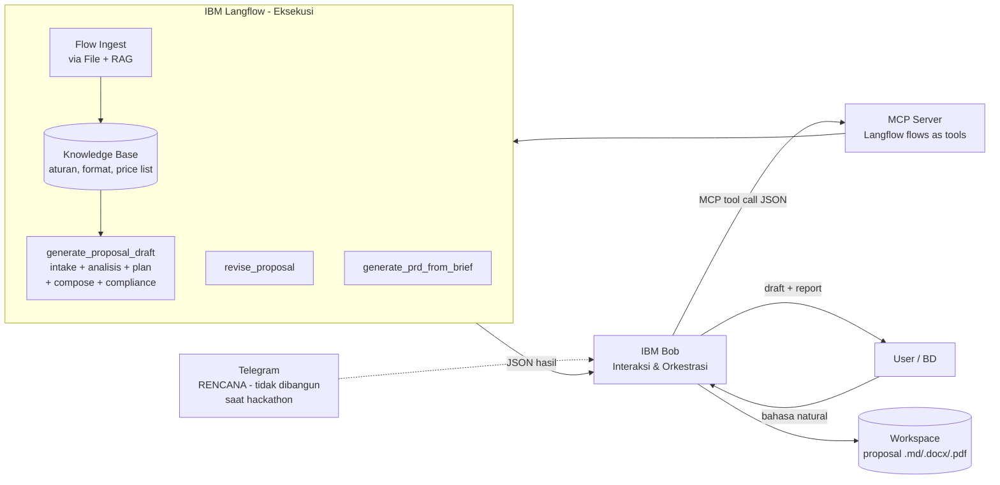

# ARCHITECTURE — BidMaster

## 1. Prinsip
Sesuai aturan hackathon: **User → IBM Bob (interaksi) → MCP → IBM Langflow (eksekusi)**. Telegram hanya ekstensi.

## 2. Diagram



## 3. Komponen
| Komponen | Peran |
|---|---|
| IBM Bob | Menerima chat, menstrukturkan input, tanya balik, memanggil MCP, menampilkan hasil, menyimpan file |
| MCP Server | Menjembatani Bob ke flow Langflow sebagai tool |
| Langflow Flows (AKTUAL) | `generate_proposal_draft`, `revise_proposal`, `generate_prd_from_brief`; ingest via File + RAG |
| Knowledge Base | Vector store berisi aturan, format, price list, portofolio |
| LLM | Model di dalam Langflow untuk analisis dan penulisan |
| Workspace | Folder penyimpanan output dan data per proyek |
| Telegram Bridge | **RENCANA SAJA** (desain di `06-INTERFACE.md` §4; tidak dibangun saat hackathon) |

## 4. MCP Tools (kontrak AKTUAL)

Yang berjalan adalah 3 Agent flow. Lima tahap granular di bawahnya adalah
**langkah internal** di dalam `generate_proposal_draft`, bukan tool terpisah
(menyederhanakan discovery Bob dan mengurangi panggilan berantai).

| Tool (flow) | Input | Output |
|---|---|---|
| `generate_proposal_draft` | info client bebas + knowledge | proposal 10 bab + `compliance_report` |
| `revise_proposal` | instruksi + versi terakhir | versi baru + diff ringkas + compliance ulang |
| `generate_prd_from_brief` | brief / proposal disetujui | PRD terstruktur |

Tahap internal `generate_proposal_draft` (dipetakan dari desain 5-flow):
intake → `analyze` (strengths, weaknesses, needs) →
`plan` (web_plan, packages[3], timeline, RAB-lite) →
`compose` (proposal_md) → `check` (passed, violations[], suggestions[]).

## 5. Skema Data (ringkas)
```json
{
  "client_profile": {
    "name": "", "industry": "", "website": "", "socials": [],
    "needs": "", "budget_hint": "", "notes": ""
  },
  "packages": [
    {"name": "Basic", "price": 0, "features": [], "duration_weeks": 0}
  ],
  "compliance_report": {"passed": true, "violations": [], "suggestions": []}
}
```

## 6. Aliran Data
1. User → Bob: teks bebas.
2. Bob: ekstraksi dan validasi → `client_profile`; kekurangan info → tanya balik.
3. Bob → MCP `generate_proposal_draft` → Langflow (intake → analisis → plan → compose → compliance internal).
4. Langflow → Bob: proposal + compliance report; jika gagal, Bob menawarkan perbaikan lalu memanggil ulang.
5. Revisi: Bob → MCP `revise_proposal` (hanya bagian terdampak).
6. Bob menyimpan file dan menampilkan hasil.

## 7. Keamanan
- Kunci API di `.env`; tidak di-commit.
- Data client hanya di workspace pengguna.
- Semua klaim non-faktual ditandai; harga hanya dari price list.

## 8. Deployment (hackathon)
Langflow dijalankan lokal/container; MCP endpoint diakses Bob dari mesin yang sama; Telegram bridge **tidak dibangun** (rencana, lihat `06-INTERFACE.md` §4).

## 9. Keputusan Desain
| Keputusan | Alasan |
|---|---|
| Logika berat di Langflow, bukan di Bob | Mudah diubah visual dan sesuai aturan lomba |
| Compliance sebagai flow terpisah | Bisa diuji dan dijelaskan ke juri |
| Harga dari price list terstruktur | Mencegah halusinasi angka |
