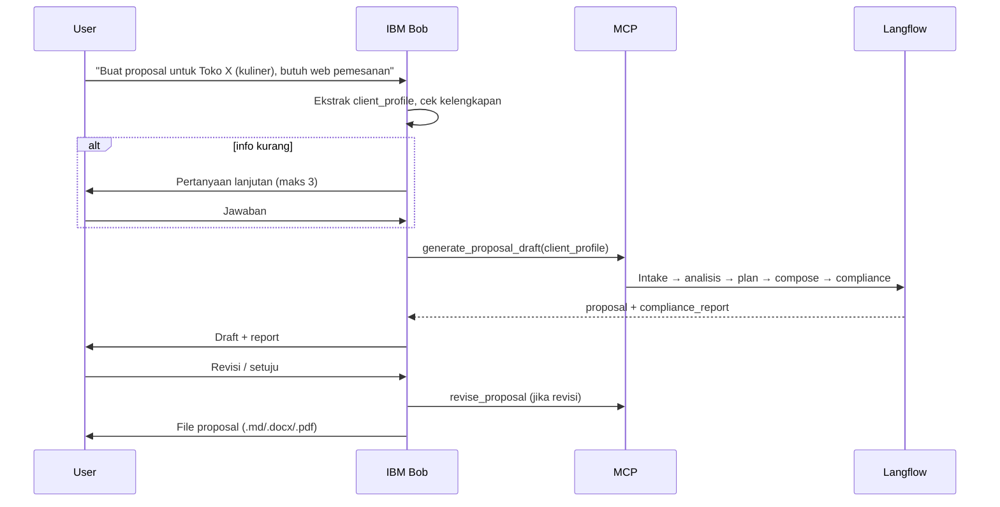

# WORKFLOW — BidMaster

## 1. Workflow Utama

## 2. Workflow Setup (sekali)
1. User memberikan aturan perusahaan, format proposal, price list, portofolio.
2. Knowledge masuk Langflow via komponen File + RAG (`ingest` internal, bukan tool terpisah).
3. Bob mengonfirmasi ringkasan aturan yang terbaca; user mengoreksi jika salah.

## 3. Workflow Revisi
1. User: "Turunkan harga paket Premium" / "Tambah fitur booking".
2. Bob memanggil `revise_proposal` (hanya bagian terdampak, bukan seluruh pipeline).
3. Compliance dijalankan ulang di dalam flow.
4. Bob menampilkan perubahan (diff ringkas).

## 4. Penanganan Kegagalan
| Kondisi | Aksi |
|---|---|
| MCP/Langflow tidak merespons | Bob memberi tahu, coba ulang 1x, lalu tawarkan draft dari template dasar |
| Compliance gagal | Tampilkan pelanggaran dan usulan perbaikan; jangan export sebagai final |
| Info client tidak cukup | Tandai `[perlu konfirmasi]`, jangan mengarang |
| Harga di luar price list | Blokir dan minta persetujuan manusia |

## 5. Human-in-the-loop
Persetujuan wajib sebelum: harga final, diskon di luar batas, pengiriman proposal ke client.

## 6. Ekstensi Telegram — RENCANA (tidak dikerjakan saat hackathon)
Desain beku di `06-INTERFACE.md` §4 (perintah `/start`, `/proposal`, `/revisi`,
`/setuju`, tombol Setuju/Revisi). Syarat mulai: MVP stabil + sisa waktu ≥ 1 hari.
